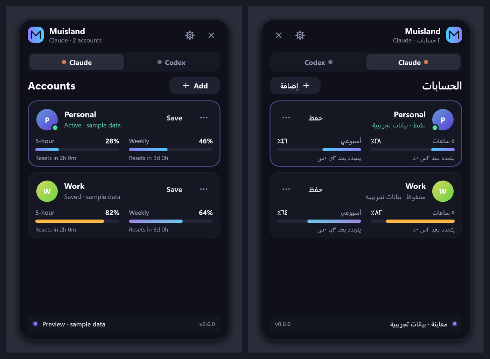
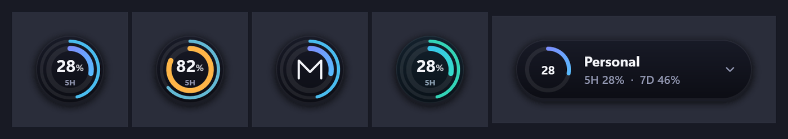
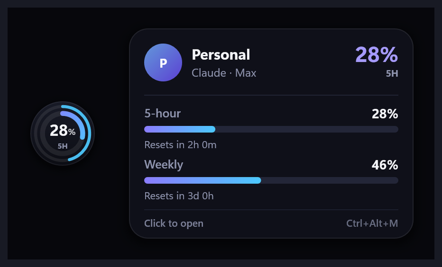
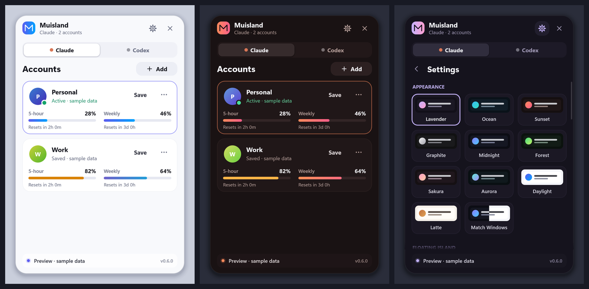
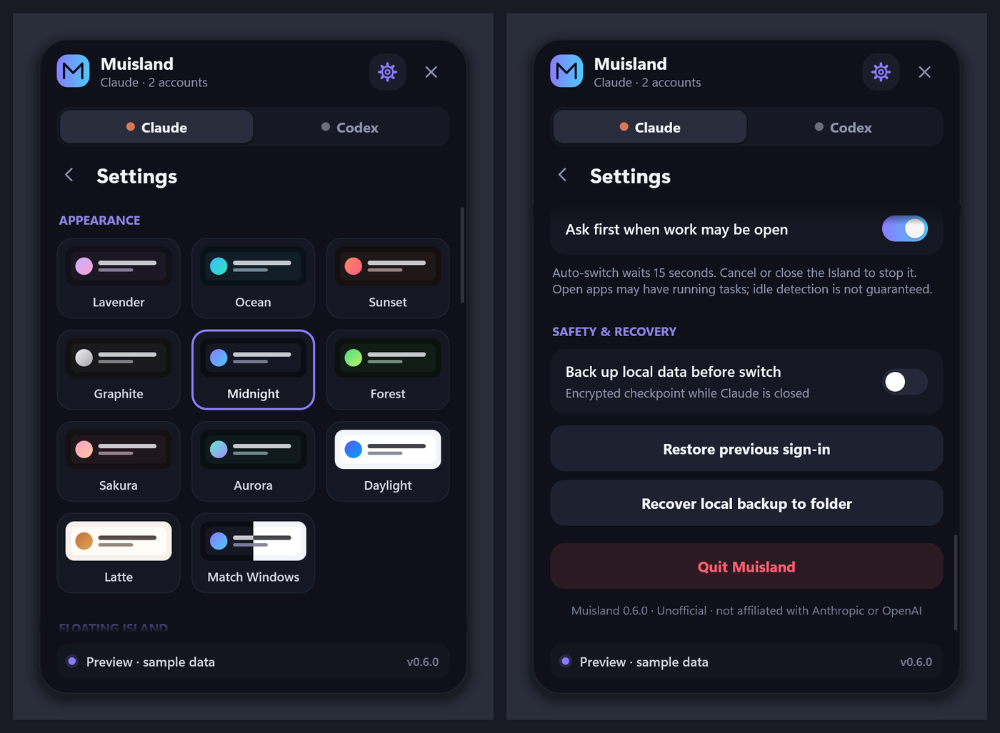

# Muisland

**Your Claude and Codex accounts, one floating island.**

An account and usage companion for **Claude and Codex**, with a native Rust/Win32 interface on Windows and a GTK/WebKitGTK shell on Linux. Keep separate provider profiles, automatic quotas, and a compact floating pill or circle. **Ubuntu/Linux support is beta.**

<p>
  <a href="https://muhameho.github.io/Muisland/"></a>
</p>

> Unofficial project. Muisland is not affiliated with or endorsed by Anthropic or OpenAI. Local authentication formats and usage protocols can change.

[Gallery](#gallery) · [Interactive demo](#interactive-demo) · [Getting started](#build-and-run) · [Controls](#controls-and-motion) · [Privacy](#usage-and-privacy) · [Troubleshooting](#troubleshooting)

## Gallery

All images use invented accounts and offline sample data. Click an image to view it at full size.

### In motion


Rendered frame by frame by the Windows app itself (`--render-motion`) using the same springs as the live window: the circle morphs into the panel, pages slide and fade, and the panel folds back into the circle.

<details open>
<summary><strong>Accounts — usage and account switching, in English or Arabic</strong></summary>



Each account has an avatar, its session and weekly quotas with reset countdowns, and quick Save and details actions. Switching always asks for confirmation. The whole interface mirrors for Arabic.

</details>

<details>
<summary><strong>Floating island — circle with a live percentage, or a pill</strong></summary>



The default circle shows the session percentage inside two usage rings (session inside, weekly outside). Rings shift from the theme accent to amber and red as limits approach.

</details>

<details>
<summary><strong>Hover card — readable at any island size</strong></summary>



The card chooses the free side of the screen and stays within the usable monitor area.

</details>

<details>
<summary><strong>Themes — ten looks, light and dark</strong></summary>



</details>

<details>
<summary><strong>Settings</strong></summary>



</details>

## Interactive demo

**[Open the live interactive playground](https://muhameho.github.io/Muisland/)** · [Download the standalone HTML](demo/index.html?raw=1) · [View its source](demo/index.html)

The demo is hosted on GitHub Pages from `demo/`, separately from documentation. It opens directly in the browser; no download or setup is needed. It is the actual Linux interface (`demo/index.html` is a copy of `linux/island.html`) running on sample accounts: hover the circle for the usage card, click it to open the panel, drag it around, try the themes and Arabic, and move the usage sliders to watch the rings change colour.

Use the live link, or save the HTML file and open it in a browser for offline use. It is self-contained: no build step, backend, external fonts, or Claude connection. If GitHub opens the source view, choose **Download raw file** and open the saved file.

Try these interactions:

1. Hover the **M** to reveal the usage bubble, then move the pointer onto the card.
2. Drag the circle, or use the corner buttons, to test left/right bubble placement.
3. Click the circle or bubble to open the menu; click the desktop or press Escape to close it.
4. Select **Work**, review the confirmation, and switch the sample active account.
5. Rename a sample account, add another account, and try the page arrows.
6. Open **Make it yours**, shrink the circle, and keep the bubble at 100%.
7. Change the sample usage slider to see the progress bars and ring update.

The demo is a browser simulation, not the Windows executable, and still shows the previous design; the Windows app now uses the redesigned interface shown in the gallery. All account operations are simulated and disappear on reset/reload. GitHub READMEs do not execute the demo's JavaScript; the gallery and expandable sections work directly on GitHub.

After cloning the repository, open it locally with:

```powershell
Start-Process .\demo\index.html
```


## Features

- **Claude / Codex tabs** — keep provider profiles and usage separate.
- **Ten themes** — Midnight (default), Lavender, Ocean, Sunset, Graphite, Forest, Sakura, Aurora, Daylight and Latte, plus *Match Windows*, which follows the system light/dark setting.
- **English and Arabic** — the interface mirrors right-to-left for Arabic. It follows the Windows display language until you choose one.
- **Multiple accounts** — save up to 64 accounts per provider, give them names, and remove them from the island.
- **Confirmed switching** — review the target account before switching. Selecting the current account shows that it is already logged in.
- **Automatic usage** — view the 5-hour and weekly quotas, percentage used, and reset countdowns.
- **Circle by default** — a draggable circle showing the live percentage inside session and weekly rings; choose the 5-hour, weekly or highest value, or show the logo instead. A pill is also available. A separate hover card picks the free side of the screen.
- **Independent sizes** — adjust the panel, floating island, and hover card separately.
- **Smooth, sharp rendering** — Direct2D/DirectWrite with anti-aliasing, real transparency and per-monitor DPI; spring animations are paced to the display's refresh rate. *Remove animations* (Settings → General) makes every change instant.
- **Tray icon and shortcut** — a live usage ring in the notification area (left-click opens, right-click for a menu), Windows notifications for usage alerts while the panel is closed, and **Ctrl+Alt+M** to open from anywhere. You can hide the floating island and keep only the tray icon.
- **Start with Windows** — optional, from Settings.
- **Screen-aware positioning** — the island stays within the monitor's usable area; closing the menu restores the floating position.
- **In-island controls** — settings, confirmations, and errors appear inside Muisland. Click outside or on the open header to collapse it.
- **Optional local backups** — an encrypted copy of Claude's local data (sessions, settings, storage; caches and downloads skipped) before each switch, in well under a second for typical data. The latest three are kept, and the newest restores to a separate folder.

## Build and run

### Windows

- Windows with Claude Desktop and/or Codex installed and signed in.
- [Rust](https://www.rust-lang.org/tools/install), using the MSVC toolchain.
- Visual Studio Build Tools with **Desktop development with C++** and the Windows SDK.

```powershell
git clone https://github.com/muhameho/Muisland.git
cd Muisland
.\build.ps1
```

The script builds the release version, copies `Muisland.exe` to the project folder, and launches it. To build without launching:

```powershell
cargo build --release
```

The output is `target\release\muisland.exe`. Build outputs are excluded from Git; `Cargo.lock` is tracked for reproducible dependency versions.

### Ubuntu / Debian and other Linux desktops (beta)

[Linux installation, supported desktop sessions, and an actual GTK screenshot](docs/LINUX.md)

Ubuntu is a Linux distribution. The Linux port targets Ubuntu 24.04 first, with equivalent packages needed on other distributions. The launcher embeds its Python runtime sources and UI; it uses the system Python and GTK libraries rather than replacing the Windows renderer.

```bash
sudo apt update
sudo apt install build-essential pkg-config python3 python3-gi python3-gi-cairo \
  python3-cryptography gir1.2-gtk-3.0 gir1.2-webkit2-4.1 libsecret-tools
# Install Rust using rustup if cargo is not available.
git clone https://github.com/muhameho/Muisland.git
cd Muisland
bash build.sh
./target/release/muisland
```

To build a Debian/Ubuntu package, run `bash build.sh --deb`, then install the resulting `dist/muisland_0.6.0_<architecture>.deb` using `sudo apt install ./muisland_0.6.0_amd64.deb`. `bash build.sh --tar` creates a compiled archive; `bash build.sh --source` creates an architecture-independent **linux-any** archive with the Python/GTK runtime, a distro dependency helper, per-user installer, and desktop icon. Use linux-any for Fedora/Arch/openSUSE/Alpine and other compatible native-library environments. See the [Linux installation and desktop guide](docs/LINUX.md). The build workflow also provides Windows and Ubuntu artifacts under [GitHub Actions](https://github.com/muhameho/Muisland/actions/workflows/build.yml).

- **X11:** floating placement, corner clamping, dragging, and an independent hover window.
- **Wayland sessions with XWayland:** the port selects the X11 backend when `DISPLAY` is available, retaining those placement controls.
- **Native Wayland with GTK Layer Shell (KDE/Sway/wlroots):** floating placement and a draggable circle use the layer-shell protocol. Select it using `GDK_BACKEND=wayland`. GNOME uses XWayland for floating placement; an ordinary native Wayland window cannot override compositor restrictions.
- **Desktop integration:** a proper app icon and launcher, launch-again-to-open, optional XDG autostart, saved floating location, monitor-change recovery, and `--reset-position` / `--show` / `--quit` commands.
- **Storage:** an unlocked Secret Service desktop keyring is required. There is no plaintext fallback for Muisland's own profiles.
- **Claude Desktop:** the official Linux beta supports Ubuntu/Debian. Detection uses `$XDG_CONFIG_HOME/Claude`, `claude`, or `claude-desktop`; `MUISLAND_CLAUDE_CONFIG` can specify the correct profile directory. Linux credential decryption supports Chromium v10/v11 safe-storage formats and fails safely for unrecognized formats.

Linux builds, encrypted-backend tests, a real Secret Service roundtrip, and X11/native Wayland smoke tests run on Ubuntu 22.04 and 24.04. A real signed-in Claude session on Linux and every desktop compositor have **not** been verified. See [Anthropic's Linux requirements](https://support.claude.com/en/articles/10065433-install-claude-desktop).

## Providers

Choose **Claude** or **Codex** above the account list. Tabs have separate saved profiles and quota caches; changing tabs does not switch either app's real account. Size controls and the theme are shared preferences. Provider changes are blocked while an account operation is running.

### Codex support and limits

Codex support uses ChatGPT **file-based authentication** in `$CODEX_HOME/auth.json` (default: `~/.codex/auth.json`) and the official Codex app-server protocol:

- **Save** encrypts the current Codex file sign-in in Muisland's own storage.
- **Switch**, after confirmation, backs up and replaces that sign-in cache. **New CLI sessions** use the new cache. Existing processes must reload/restart; a separately authenticated Desktop host may retain its own login. Muisland does not terminate Codex or a running agent automatically.
- **Usage** comes from `account/rateLimits/read`, using an isolated app-server process with ephemeral credentials and analytics disabled. No inference turns, chats, or project files are sent. Session and extended limits are account-policy dependent; missing windows are unavailable.
- Install Codex CLI on `PATH`, or set `MUISLAND_CODEX_BIN` to its executable. Windows also detects the installed Codex app's bundled CLI.
- API-key-only, OS-keyring-only, and externally managed Desktop authentication are not interchangeable with this file-cache switcher. Muisland does not change your credential-storage policy or export tokens through the UI.

See the official [authentication](https://learn.chatgpt.com/docs/auth) and [app-server](https://learn.chatgpt.com/docs/app-server) documentation. Switching authentication does not transfer chats, threads, workspaces, or project ownership between accounts.

## Using Claude accounts

1. Sign in to the desired account in Claude Desktop.
2. Choose **Save** on the intended slot in Muisland. Use **+ Add account** for another slot.
3. If Claude is running, review **Close & save**. Muisland closes Claude (including when it is only in the system tray), captures the sign-in, and reopens Claude.
4. To add a second account, choose **+ Add account → Save account** while the first one is still signed in. Because that account is already saved, Muisland reopens Claude at its sign-in screen instead of saving a duplicate. Sign in to the other account, then choose **Save** again.
5. Click a saved account and choose **Confirm switch** to switch to it.

**Do not use Claude's own Log out to change accounts.** Log out ends that session on Anthropic's side, so the saved copy stops working and a later switch asks you to sign in again. Step 4 only forgets the sign-in on this computer; the saved session stays valid. Each switch also re-captures the account you are leaving, so its saved copy follows Claude's own session renewals.

**+ Add account** creates a temporary draft. Enter a name and choose **Save account** to capture the Claude sign-in. The new entry becomes permanent only after capture succeeds. Back, Cancel, Escape, or closing the island discards an unfinished draft; saving unrelated preferences cannot accidentally keep it. A confirmed save already running is allowed to finish safely.

Use an account card's **⋯** button to rename or remove it. Removing an account archives its encrypted snapshot locally; it does not sign Claude out or delete cloud chats.

After you confirm, Muisland asks Claude to close normally and waits for it to finish. It does not force-terminate Claude after a timeout. If the tray instance remains open, quit it from its own tray menu and retry. Finish local work before confirming, and let a new sign-in finish loading before Save.

**Saved sign-ins are not permanent credentials.** If Claude expires or revokes a session, including after a sign-out, you may need to sign in again and save the account. A local snapshot cannot undo server-side revocation.

## Appearance

Open the header **gear icon** for Settings. It lists five categories, each showing its current values:

| Category | Contains |
| --- | --- |
| Appearance & language | Theme (or *Match Windows*) and language |
| Floating island | Show or hide the island, circle or pill, what is inside the circle (percentage or logo) and which usage it shows, and the three sizes |
| Alerts & auto-switch | Usage alerts and their limits, automatic switching, and asking first when Claude may be busy |
| General | Start with Windows, tray icon, Ctrl+Alt+M, and *Remove animations* |
| Backup & recovery | Back up Claude's data before switching, restore the latest backup to a folder, open the backups folder, and undo the last account switch |

**Quit Muisland** is at the bottom of the list and asks for confirmation. Three sizes are independent:

| Setting | Range | Controls |
| --- | --- | --- |
| Panel size | 75–160% | The expanded panel |
| Island size | 60–180% | The collapsed circle or pill |
| Hover card size | 85–160% | The separate account and usage card |

Sizes are relative to the monitor's scaling, so the island looks the same on 100% and 200% displays. The hover card stays readable when the circle is small, and fits smaller only when the monitor lacks room.

## Controls and motion

| Interaction | Result |
| --- | --- |
| Drag the circle or pill | Moves the floating island; the position is remembered and kept on screen |
| Hover the circle | Reveals the usage card with a spring fade, scale and slide |
| Click the circle, the card, or press **Ctrl+Alt+M** | Opens the panel |
| Click the open header | Collapses the panel, except for its buttons |
| Drag the open header | Moves the panel |
| Scroll the account list or Settings | Smooth scrolling; Page Up/Down also work |
| Click outside, or press Escape on the accounts page | Collapses the panel and abandons an unconfirmed action |
| Press Escape on another page | Goes back |
| Tab / Shift+Tab, Enter or Space | Moves keyboard focus and activates it |
| Click an account card | Opens switch confirmation, or reports that it is already logged in |
| Click an account's **⋯** button | Renames or removes the account |
| **Moving a Cowork task?** box in the Claude switch dialog | Copies a request that makes each Cowork task save `HANDOFF.md` (goal, what is done, what is left, decisions) at the top of its folder. Muisland watches the fixed drives for that file, so it learns each task's real Windows folder, several at once; *Choose folder* is a manual fallback. After the switch it opens Cowork on the first project through `claude://cowork/new?folder=…` (Claude asks once before using the folder) and copies the continue request; paste it with Ctrl+V. Other projects are listed on Accounts with an Open button. The request is not put in the link because Claude marks every prompt that arrives by link with a caution note. Cowork chats themselves stay on Claude's servers per account. |
| Tray icon | Left-click opens or closes; right-click offers Settings, Show floating island, Reset position and Quit |
| Header **tray** button (arrow into a tray) | Minimizes to the tray: collapses the panel and hides the floating island; click the tray icon or press **Ctrl+Alt+M** to restore the island and open the panel. To keep only the tray icon permanently, turn off *Settings → Show floating island* |

The island morphs into the panel with spring physics, pages slide in the direction you navigate, toggles and segmented controls glide, and usage rings ease toward each new reading. Frames are presented on the display's vertical blank; when nothing moves, Muisland sleeps and uses no CPU.

## Usage and privacy

Usage refreshes automatically: approximately every **30 seconds** for the active account and **2 minutes** for other saved accounts. This is polling, not a server-pushed live stream. Windows polls the selected provider tab and schedules a new read when you change tabs; Linux polls saved profiles for both providers. Errors trigger backoff, rate limits honor `Retry-After`, and expired authentication pauses retries. A missing reading is shown as unavailable rather than 0%.

Percentages mean **quota consumed**. Reset countdowns indicate when the quota resets, not guaranteed remaining working hours.

Muisland reads the account's locally stored Claude session and uses it for read-only HTTPS requests to:

```text
https://api.anthropic.com/api/oauth/usage
```

- Each account uses its own locally saved session; no shared API key is required or bundled.
- Usage requests do not send chats or project files. Cookie-only Linux Desktop sessions can use account/org-bound local usage samples, without sending browser cookies anywhere. Local readings and missing reset windows are labelled.
- Redirects are disabled and Windows certificate validation remains enabled.
- Credentials are not printed by the usage diagnostic.
- Muisland does not refresh or extend Claude sessions.

The usage integration relies on Claude's local storage format and an unofficial compatibility endpoint. It may stop working after a Claude update. [CodexBar's Claude provider documentation](https://github.com/steipete/CodexBar/blob/main/docs/claude.md) is a useful reference; Muisland's implementation is independent.

## Chats, work, and backups

**Switching accounts does not transfer chats or tasks between accounts.** Cloud conversations stay with the account that owns them. Closing Claude can interrupt local tasks or unsaved work.

| Option | What it does |
| --- | --- |
| Back up Claude's data before switching (Settings → Backup & recovery) | Creates an encrypted checkpoint of ordinary files in the detected Claude app-data folder while Claude is closed. Folders Claude rebuilds or downloads itself are skipped (`vm_bundles`, `claude-code`, `claude-code-vm`, browser caches, crash reports and logs), which turns a multi-gigabyte copy into a few megabytes. Files are packed into one stream sealed with AES-256-GCM under a random per-backup key that DPAPI protects for your Windows user. The latest three backups are kept. Switching is cancelled if checkpointing fails. |
| Restore latest backup to a folder | Decrypts the latest complete checkpoint into a separate folder, without overwriting Claude's live data. Tampered or truncated backups are rejected. |
| Show Code sessions in every account (Settings → Backup & recovery, on by default) | Claude Desktop lists Code-tab sessions per account (`claude-code-sessions/<account>/<org>/local_<id>.json`), while the conversations themselves live in `~/.claude` and are shared. During each switch, while Claude is closed, Muisland copies every session file into every account's folder; the newest copy wins, nothing is deleted, and replaced copies are kept in `shared-sessions-replaced`. Cowork chats are stored by Claude per account on its servers and are not affected; Codex keeps one local history for all accounts already. |
| Undo last account switch | Restores the authentication backup from the last switch; separate from local-data recovery. |

Local checkpoints do not export cloud chats, copy external project folders, or capture running processes or virtual machines. Recovered files may contain sensitive app data and are not automatically imported into Claude.

## Local storage

On Windows, Muisland keeps `%LOCALAPPDATA%\ClaudeIsland` for compatibility:

| Path | Contents |
| --- | --- |
| `account-N` | Encrypted sign-in snapshots |
| `muisland-settings.bin` | Encrypted provider profiles, cached usage, themes, and preferences |
| `codex` | Separately encrypted Codex snapshots and the prior sign-in backup |
| `local-backups` | Encrypted local checkpoints |
| `saved-versions` | Previous encrypted sign-in snapshots |
| `removed-accounts` | Archived account snapshots |
| `recovered` | Decrypted recovery output |

On Linux, data is stored in `$XDG_DATA_HOME/muisland` (default `~/.local/share/muisland`). Settings, provider snapshots, archived profiles, and backup chunks use AES-256-GCM; the random master key is stored in Secret Service. Files are private to the user (data root 0700, encrypted files 0600). Recovery output is deliberately decrypted in a separate `recovered` directory.

Windows encryption uses DPAPI and is tied to the current Windows user. It does not protect against other software running as that user. Treat snapshots, backups, and recovered files as sensitive; do not commit or share them.

## Troubleshooting

<details>
<summary><strong>Why is usage unavailable or behind Claude?</strong></summary>

Muisland polls rather than streaming updates. Allow the next refresh interval after a save or switch. Authentication errors may need a fresh Claude sign-in and another Save; rate limits and network errors back off automatically. An expired or revoked session cannot be repaired by a local snapshot. Claude updates may also change the storage format or usage endpoint.

</details>

<details>
<summary><strong>Claude did not close, or is still in the tray</strong></summary>

Muisland requests normal exit and waits. If Claude remains in its tray or is still finishing work, the operation stops without editing authentication files. Quit Claude from its tray and retry. Muisland does not force-terminate it.

</details>

<details>
<summary><strong>Switching asked me to sign in again</strong></summary>

The saved session was ended on Anthropic's side, most often by using Claude's own **Log out** to change accounts, or because the saved copy was much older than Claude's renewed session. Sign in once, choose **Save** on that slot, and from then on add or change accounts through Muisland (see *Using Claude accounts*) instead of Log out.

</details>

<details>
<summary><strong>Will switching carry my chats or Cowork tasks to another account?</strong></summary>

No. Cloud data stays with its owning account. The local backup option protects ordinary app-data files; it is not a cloud-chat export, cross-account migration, or checkpoint of a running task or virtual machine. External project folders need their own backups.

</details>

<details>
<summary><strong>The circle is tiny — how do I keep the card readable?</strong></summary>

Settings has separate **Island size** and **Hover card size** controls. Start with a small circle and a 100% card. The expanded panel also has its own size control. The card only fits smaller automatically when the monitor lacks room.

</details>

<details>
<summary><strong>Why does Windows SmartScreen show a warning?</strong></summary>

Locally built binaries may be unsigned. Build the source yourself and review the repository. Do not assume a binary from an unrelated download is an official Muisland release.

</details>

## Development

```powershell
cargo fmt --check
cargo test
cargo build --release
```

Add `--offline` to Cargo commands when dependencies are already cached. Linux backend tests run with `python3 -m unittest discover -s linux -v`. The smoke check uses `dbus-run-session -- xvfb-run -a ./target/release/muisland --preview --smoke-test`.

Tests cover account isolation, confirmation ordering, backup safety, quota parsing, independent sizes, screen bounds, and floating-position restoration.

| Launch option | Purpose |
| --- | --- |
| `--preview` | Sample accounts and usage, without reading credentials, contacting the usage API, changing Claude, or persisting preferences |
| `--no-network` | Run with usage requests disabled for that process |
| `--render-previews <folder>` | Export sample UI renderings (PNG) without opening a window |
| `--render-motion <folder>` | Export 60 fps animation frames (PNG) using the live springs |
| `--show` / `--reset-position` | Windows: open the panel, or move the island back to the top of the main screen |
| `--check-usage` | Windows: read-only Claude usage diagnostic; does not print credentials |
| `--check-codex-usage` | Windows: read-only Codex quota diagnostic; does not save a profile or print credentials |
| `--check-env` | Linux: verify installed GUI and crypto dependencies |
| `--smoke-test` | Linux: sample-only GTK/WebKit startup and native bridge check |

Before contributing, keep local data and build output out of commits and scan the history with [Gitleaks](https://github.com/gitleaks/gitleaks):

```powershell
gitleaks git . --redact
```

### Repository layout

| Path | Purpose |
| --- | --- |
| `src/main.rs` | Entry points and diagnostics |
| `src/app.rs` | Windows island state, account operations, window and frame loop |
| `src/ui.rs` | Every screen, drawn immediate-mode with matching hit regions |
| `src/gfx.rs` | Direct2D/DirectWrite canvas, layered-window surfaces, PNG export |
| `src/theme.rs` | Themes and usage colours |
| `src/i18n.rs` | English and Arabic strings |
| `src/anim.rs` | Springs and easing |
| `src/system.rs` | Tray icon, notifications, start with Windows |
| `src/accounts.rs` | Account slots, names, and saved preferences |
| `src/profiles.rs` | Claude profile snapshots and close/reopen handling |
| `src/usage.rs` | Account-bound usage requests and quota parsing |
| `src/codex.rs` | Codex encrypted file profiles and official app-server quota client (Windows) |
| `linux/backend.py` | Linux encrypted storage, provider operations, backups, and quota clients |
| `linux/app.py` | GTK/WebKit floating, menu, and hover windows |
| `linux/island.html` | Linux interface, native-message bridge, and the browser demo (same design as Windows) |
| `build.sh` | Linux binary and Debian-package builds |
| `src/polling.rs` | Refresh timing, retries, and backoff |
| `src/backup.rs` | Encrypted local checkpoints and separate-folder recovery |
| `demo/index.html` | Copy of `linux/island.html` published as the browser demo; a test keeps them identical |
| `docs/images` | Curated README images and motion preview |
| `scripts/render-docs.py` | Rebuilds gallery assets from offline app renders |

To regenerate the gallery, install Pillow in your development environment, then run:

```powershell
.\Muisland.exe --render-previews preview
.\Muisland.exe --render-motion motion
python scripts/render-docs.py preview docs/images motion
```

The app renders every image itself with sample data; the script only arranges, compresses and animates them. Generated app binaries, the full `target` directory, and scratch previews remain ignored; only the curated documentation assets are tracked.

## Reporting issues

Include your Windows version, Claude Desktop version, steps to reproduce, and the expected behavior. Use sample data or redact screenshots. **Do not attach session tokens, authentication files, local backups, or decrypted recovery output.**


### Usage rings, hover cards and alerts

The floating circle uses an inner session (5-hour for Claude) ring and an outer weekly ring. By default it shows the session percentage; in Settings you can show the weekly or highest value, or the M logo. The tray icon mirrors the same ring. The hover card always shows both usage windows and available reset times; its size stays independent of the island size.

Usage alerts and automatic switching are opt-in. Set separate session and weekly percentages (5–100%). Auto-switch selects a saved, distinct account with recent usage below both limits. It shows a 15-second cancellable countdown inside the Island. While the panel is closed and the tray icon is enabled, alerts also appear as Windows notifications. Closing the Island cancels it. “Ask first when work may be open” is enabled by default: Claude being open, or Codex sessions whose idle state is unknown, requires confirmation instead of unattended switching. Muisland cannot reliably detect all running projects. Switching may stop tasks; Codex sessions must restart to reload credentials, and chats are not transferred between accounts. Failed/stale quota readings never trigger automatic switching.
