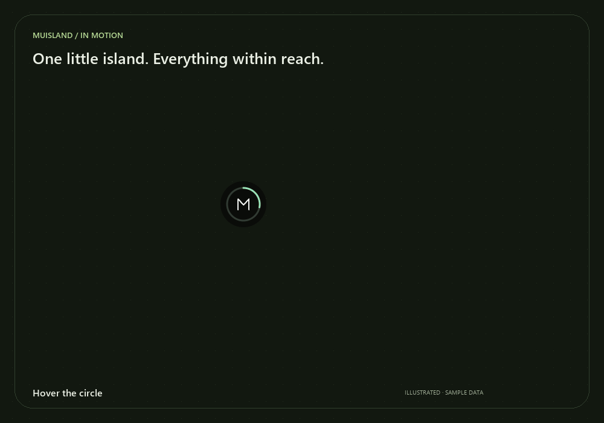
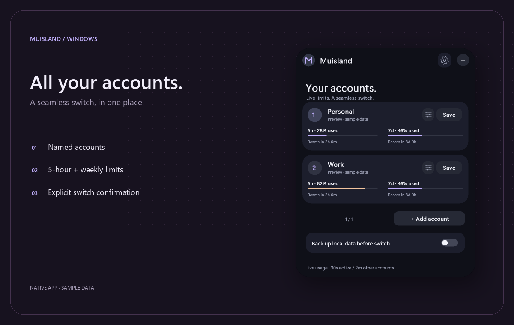
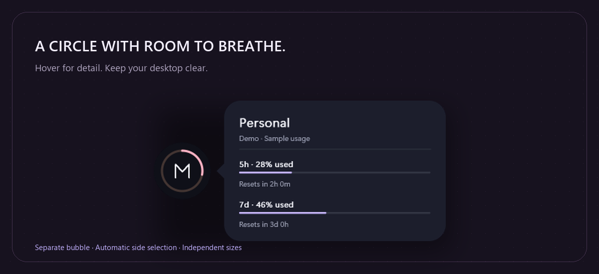
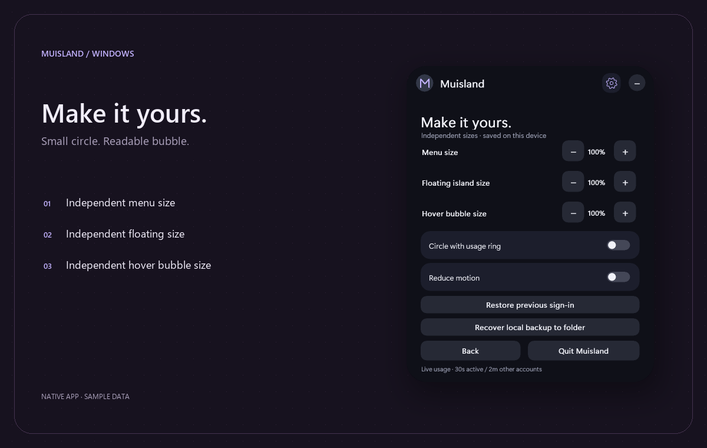

# Muisland

**Your Claude accounts, one floating island.**

A native Windows companion for Claude Desktop, built with Rust and Win32. Save account sign-ins, switch between them, and keep an eye on usage from a compact floating pill or circle.

<p>
  <a href="https://muhameho.github.io/Muisland/"></a>
</p>

> Unofficial project. Muisland is not affiliated with or endorsed by Anthropic. Claude's local storage and usage endpoint may change.

[Gallery](#gallery) · [Interactive demo](#interactive-demo) · [Getting started](#build-and-run) · [Controls](#controls-and-motion) · [Privacy](#usage-and-privacy) · [Troubleshooting](#troubleshooting)

## Gallery

All images use invented accounts and offline sample data. Click an image to view it at full size.

### In motion



An illustrated motion preview built from the native app's sample renders. For hands-on clicks, dragging, and settings, use the [interactive demo](#interactive-demo).

<details open>
<summary><strong>Accounts — usage and account switching</strong></summary>



Each account has its own name, session quota, weekly quota, and reset countdowns. Switching asks for confirmation before changing the active session.

</details>

<details>
<summary><strong>Circle — a separate, readable hover bubble</strong></summary>



Keep the circle small and the bubble readable. The card chooses the available side of the screen and stays within the usable monitor area.

</details>

<details>
<summary><strong>Preferences — three independent sizes</strong></summary>



The expanded menu, floating island, and hover bubble each have their own size control. Reduce motion makes transitions immediate.

</details>

## Interactive demo

**[Open the live interactive playground](https://muhameho.github.io/Muisland/)** · [Download the standalone HTML](demo/index.html?raw=1) · [View its source](demo/index.html)

The demo is hosted on GitHub Pages from `demo/`, separately from documentation. It opens directly in the browser; no download or setup is needed.

Use the live link, or save the HTML file and open it in a browser for offline use. It is self-contained: no build step, backend, external fonts, or Claude connection. If GitHub opens the source view, choose **Download raw file** and open the saved file.

Try these interactions:

1. Hover the **M** to reveal the usage bubble, then move the pointer onto the card.
2. Drag the circle, or use the corner buttons, to test left/right bubble placement.
3. Click the circle or bubble to open the menu; click the desktop or press Escape to close it.
4. Select **Work**, review the confirmation, and switch the sample active account.
5. Rename a sample account, add another account, and try the page arrows.
6. Open **Make it yours**, shrink the circle, and keep the bubble at 100%.
7. Change the sample usage slider to see the progress bars and ring update.

The demo is a browser simulation, not the Windows executable. All account operations are simulated and disappear on reset/reload. GitHub READMEs do not execute the demo's JavaScript; the gallery and expandable sections work directly on GitHub.

After cloning the repository, open it locally with:

```powershell
Start-Process .\docs\demo\index.html
```


## Features

- **Multiple accounts** — save up to 64 accounts, give them names, and remove them from the island.
- **Confirmed switching** — review the target account before switching. Selecting the current account shows that it is already logged in.
- **Automatic usage** — view the 5-hour and weekly quotas, percentage used, and reset countdowns.
- **Pill or circle** — a draggable circle with an M and a usage ring, plus a separate hover bubble that chooses the available side of the screen.
- **Independent sizes** — adjust the menu, floating island, and hover bubble separately.
- **Smooth motion** — animated opening, navigation, and hover, with a Reduce motion option.
- **Screen-aware positioning** — the island stays within the monitor's usable area; closing the menu restores the floating position.
- **In-island controls** — settings, confirmations, and errors appear inside Muisland. Click outside or on the open header to collapse it.
- **Optional local backups** — create an encrypted checkpoint before switching and recover it to a separate folder.

## Build and run

### Requirements

- Windows with Claude Desktop installed and signed in.
- [Rust](https://www.rust-lang.org/tools/install), using the MSVC toolchain.
- Visual Studio Build Tools with **Desktop development with C++** and the Windows SDK.

```powershell
git clone https://github.com/muhameho/Muisland.git
cd Muisland
.\build.ps1
```

The script builds the release version, copies `Muisland.exe` to the project folder, and launches it. To build without launching:

```powershell
cargo build --release
```

The output is `target\release\muisland.exe`. Build outputs are excluded from Git; `Cargo.lock` is tracked for reproducible dependency versions.

## Using accounts

1. Sign in to the desired account in Claude Desktop.
2. Choose **Save** on the intended slot in Muisland. Use **+ Add account** for another slot.
3. If Claude is running, review **Close & save**. Muisland requests a normal exit, waits for Claude to stop, captures the sign-in, and reopens Claude.
4. Click a saved account and choose **Confirm switch** to switch to it.

**+ Add account** creates a temporary draft. Enter a name and choose **Save account** to capture the Claude sign-in. The new entry becomes permanent only after capture succeeds. Back, Cancel, Escape, or closing the island discards an unfinished draft; saving unrelated preferences cannot accidentally keep it. A confirmed save already running is allowed to finish safely.

Use an account card's **adjustments icon** to rename or remove it. Removing an account archives its encrypted snapshot locally; it does not sign Claude out or delete cloud chats.

Muisland does not force-kill Claude. If Claude remains in the system tray, quit it normally and retry. Finish or save local work before confirming a close or switch.

**Saved sign-ins are not permanent credentials.** If Claude expires or revokes a session, including after a sign-out, you may need to sign in again and save the account. A local snapshot cannot undo server-side revocation.

## Appearance

Open the header **gear icon** to access Preferences:

| Setting | Range | Controls |
| --- | --- | --- |
| Menu size | 75–160% | The expanded menu |
| Floating island size | 60–180% | The collapsed pill or circle |
| Hover bubble size | 85–160% | The separate account and usage card |

The hover bubble defaults to 100%, independently of the circle. Shrinking the circle keeps the card readable. Its position and size fit the available monitor space when necessary.

Drag the collapsed island or the open menu's left header to move it. Hovering the circle shows the current account and usage; moving onto the bubble keeps it visible, and clicking it opens the menu. **Reduce motion** disables transitions.

## Controls and motion

| Interaction | Result |
| --- | --- |
| Drag the collapsed pill or circle | Moves the floating island; screen bounds keep it reachable |
| Hover the circle | Reveals a separate usage bubble with a short eased fade, scale, and slide |
| Move from circle to bubble | Keeps the card visible, with a short grace period across the gap |
| Click the circle or bubble | Opens the account menu |
| Click the open header | Collapses the menu, except for the gear icon |
| Drag the left header | Moves the open menu |
| Click outside | Collapses the menu and abandons an unconfirmed action |
| Press Escape | Returns to the account page from a subpage, or collapses the account menu |
| Click an account card | Opens switch confirmation, or reports that it is already logged in |
| Click an account's adjustments icon | Opens naming and removal controls |
| Enable Reduce motion | Makes transitions immediate |

The native window uses spring motion for opening and resizing, a short fade for account-page navigation and a directional fade/slide into and out of Preferences, and an eased hover reveal. Menu fitting has its own geometry: opening a larger menu near a corner does not replace the saved floating position. Closing returns the circle or pill to that position.

## Usage and privacy

Usage refreshes automatically: approximately every **30 seconds** for the active account and **2 minutes** for other saved accounts. This is polling, not a server-pushed live stream. Errors trigger backoff, rate limits honor `Retry-After`, and expired authentication pauses retries. A missing reading is shown as unavailable rather than 0%.

Percentages mean **quota consumed**. Reset countdowns indicate when the quota resets, not guaranteed remaining working hours.

Muisland reads the account's locally stored Claude session and uses it for read-only HTTPS requests to:

```text
https://api.anthropic.com/api/oauth/usage
```

- Each account uses its own locally saved session; no shared API key is required or bundled.
- Usage requests do not send chats or project files.
- Redirects are disabled and Windows certificate validation remains enabled.
- Credentials are not printed by the usage diagnostic.
- Muisland does not refresh or extend Claude sessions.

The usage integration relies on Claude's local storage format and an unofficial compatibility endpoint. It may stop working after a Claude update. [CodexBar's Claude provider documentation](https://github.com/steipete/CodexBar/blob/main/docs/claude.md) is a useful reference; Muisland's implementation is independent.

## Chats, work, and backups

**Switching accounts does not transfer chats or tasks between accounts.** Cloud conversations stay with the account that owns them. Closing Claude can interrupt local tasks or unsaved work.

| Option | What it does |
| --- | --- |
| Back up local data before switch | Creates an encrypted checkpoint of ordinary files in the detected Claude app-data folder while Claude is closed. Switching is cancelled if checkpointing fails. |
| Recover local backup to folder | Decrypts the latest complete checkpoint into a separate folder, without overwriting Claude's live data. |
| Restore previous sign-in | Restores the authentication backup from the last switch; separate from local-data recovery. |

Local checkpoints do not export cloud chats, copy external project folders, or capture running processes or virtual machines. Large backups require time and disk space. Recovered files may contain sensitive app data and are not automatically imported into Claude.

## Local storage

For compatibility, Muisland stores its data in `%LOCALAPPDATA%\ClaudeIsland`:

| Path | Contents |
| --- | --- |
| `account-N` | Encrypted sign-in snapshots |
| `muisland-settings.bin` | Encrypted account names, cached usage, and preferences |
| `local-backups` | Encrypted local checkpoints |
| `saved-versions` | Previous encrypted sign-in snapshots |
| `removed-accounts` | Archived account snapshots |
| `recovered` | Decrypted recovery output |

Encryption uses Windows DPAPI and is tied to the current Windows user. It does not protect against other software running as that user. Treat snapshots, backups, and recovered files as sensitive; do not commit or share them.

## Troubleshooting

<details>
<summary><strong>Why is usage unavailable or behind Claude?</strong></summary>

Muisland polls rather than streaming updates. Allow the next refresh interval after a save or switch. Authentication errors may need a fresh Claude sign-in and another Save; rate limits and network errors back off automatically. An expired or revoked session cannot be repaired by a local snapshot. Claude updates may also change the storage format or usage endpoint.

</details>

<details>
<summary><strong>Claude did not close, or is still in the tray</strong></summary>

Muisland requests Claude's normal exit and waits for it to stop. It does not force-kill the app. Quit Claude from its own tray menu, then retry the operation. Save or finish local work first.

</details>

<details>
<summary><strong>Will switching carry my chats or Cowork tasks to another account?</strong></summary>

No. Cloud data stays with its owning account. The local backup option protects ordinary app-data files; it is not a cloud-chat export, cross-account migration, or checkpoint of a running task or virtual machine. External project folders need their own backups.

</details>

<details>
<summary><strong>The circle is tiny — how do I keep the card readable?</strong></summary>

Preferences has separate **Floating island size** and **Hover bubble size** controls. Start with a small circle and a 100% bubble. The expanded menu also has its own size control. The bubble only fits smaller automatically when the monitor lacks room.

</details>

<details>
<summary><strong>Why does Windows SmartScreen show a warning?</strong></summary>

Locally built binaries may be unsigned. Build the source yourself and review the repository. Do not assume a binary from an unrelated download is an official Muisland release.

</details>

## Development

```powershell
cargo fmt --check
cargo test
cargo build --release
```

Add `--offline` to Cargo commands when dependencies are already cached. Tests cover account isolation, confirmation ordering, backup safety, quota parsing, independent sizes, screen bounds, and floating-position restoration.

| Launch option | Purpose |
| --- | --- |
| `--preview` | Sample accounts and usage, without reading credentials, contacting the usage API, changing Claude, or persisting preferences |
| `--no-network` | Run with usage requests disabled for that process |
| `--render-previews <folder>` | Export sample UI renderings without opening a window |
| `--check-usage` | Read-only usage diagnostic for the current account; does not print credentials |

Before contributing, keep local data and build output out of commits and scan the history with [Gitleaks](https://github.com/gitleaks/gitleaks):

```powershell
gitleaks git . --redact
```

### Repository layout

| Path | Purpose |
| --- | --- |
| `src/main.rs` | Native window, drawing, interaction, and menu state |
| `src/accounts.rs` | Account slots, names, and saved preferences |
| `src/profiles.rs` | Claude profile snapshots and close/reopen handling |
| `src/usage.rs` | Account-bound usage requests and quota parsing |
| `src/polling.rs` | Refresh timing, retries, and backoff |
| `src/backup.rs` | Encrypted local checkpoints and separate-folder recovery |
| `demo/index.html` | Standalone browser playground with sample data |
| `docs/images` | Curated README images and motion preview |
| `scripts/render-docs.py` | Rebuilds gallery assets from offline app renders |

To regenerate the gallery, install Pillow in your development environment, then run:

```powershell
.\Muisland.exe --render-previews preview
python scripts/render-docs.py preview docs/images
```

The image generator uses Segoe UI on Windows and falls back to Pillow's bundled font elsewhere. Generated app binaries, the full `target` directory, and scratch previews remain ignored; only the curated documentation assets are tracked.

## Reporting issues

Include your Windows version, Claude Desktop version, steps to reproduce, and the expected behavior. Use sample data or redact screenshots. **Do not attach session tokens, authentication files, local backups, or decrypted recovery output.**
