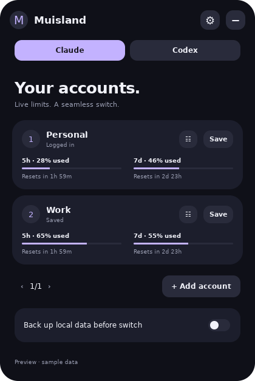

# Linux installation and desktop support

Muisland runs as a desktop application on Linux, with the same Claude/Codex profiles, usage polling, confirmations, themes, and independent size controls. Windows keeps its native Win32 renderer.



## Ubuntu / Debian package

Download the `.deb` for your architecture and Ubuntu baseline from [the build artifacts](https://github.com/muhameho/Muisland/actions/workflows/build.yml), extract the artifact ZIP, then run:

```bash
sudo apt install ./muisland_0.5.2_amd64.deb
```

Open **Muisland** in your application launcher. Installing with `apt` resolves runtime dependencies. An unlocked desktop Secret Service keyring (GNOME Keyring, or an equivalent provider) is required for encrypted profiles. Installing a keyring package does not silently unlock or migrate an existing keyring.

Ubuntu 22.04 and 24.04 build jobs exercise their own system Python, GTK, WebKitGTK, Secret Service, X11 and headless Wayland environments. Additional runtime jobs cover Debian 12, Fedora 44, Arch rolling, openSUSE Tumbleweed, and Alpine 3.23 (musl). Pick the 22.04 build for its older glibc baseline. Compiled launchers are x86-64; the **linux-any** archive has no architecture-specific launcher and uses the target machine’s native Python/GTK libraries. Other CPU architectures have not been separately tested on hardware.

## Portable archive / other distributions

The **linux-any** archive contains the GTK/Python application instead of a glibc-linked launcher. It uses the distribution's system libraries and runs on supported CPU architectures, including ARM64, without rebuilding Rust. It still needs Python 3.10+ and the runtime packages below; it is not a bundle of those libraries.

Its dependency helper prints the distro-specific package command by default. Installation is opt-in:

```bash
bash dependencies.sh           # show the native package-manager recipe
bash dependencies.sh --install # install system packages (root/sudo)
bash install.sh                # install Muisland for the current user
```

Recipes cover Ubuntu/Debian derivatives, Fedora, Arch derivatives, openSUSE, and Alpine. Unknown distribution IDs are reported with manual requirements rather than guessed. XWayland and an unlocked Secret Service keyring are installed/configured by the system; the helper does not disable sandboxing or weaken credential storage.

Install the equivalent runtime packages first:

```bash
# Ubuntu / Debian
sudo apt install python3 python3-gi python3-gi-cairo python3-cryptography \
  gir1.2-gtk-3.0 gir1.2-webkit2-4.1 libsecret-tools gnome-keyring \
  gir1.2-gtklayershell-0.1 xwayland
```

Other distributions need Python 3.10+, PyGObject with Cairo, GTK 3, WebKitGTK 4.1 (4.0 also accepted by the runtime), Python cryptography, libsecret's `secret-tool`, and a desktop Secret Service provider. Native layer-shell desktops additionally need the GTK Layer Shell introspection typelib. Distribution package names differ; the Ubuntu package cannot be installed with Fedora/Arch package managers. Use **linux-any** on those families. The compiled x86-64 archive remains available for glibc systems; **linux-any** is the option for musl systems such as Alpine.

Extract `muisland-0.5.2-linux-any.tar.gz`, open a terminal in its folder, then:

```bash
./muisland --check-env
bash install.sh
```

The installer places the binary under `~/.local/bin` and the launcher/icon under `$XDG_DATA_HOME` (normally `~/.local/share`). It needs no root privileges and quotes launcher paths, including paths containing spaces. Uninstall with `bash install.sh --uninstall`; encrypted account profiles and local backups are retained.

## Desktop behaviour

| Desktop session | Window integration |
| --- | --- |
| X11 (GNOME, KDE, Xfce, etc.) | Floating window, normal drag, separate hover card, monitor clamping and position restore. The window manager controls always-on-top policy. |
| Ubuntu/GNOME Wayland with XWayland | Automatically uses the GTK X11 backend when `DISPLAY` is available. No GNOME Shell extension is required. |
| KDE / Sway / wlroots native Wayland | Set `GDK_BACKEND=wayland`; GTK Layer Shell anchors the circle, menu and hover card, with a draggable circle and keyboard focus only for the menu. |
| Native Wayland without layer-shell support or XWayland | Managed-window fallback. Absolute positioning and always-on-top cannot be guaranteed by an ordinary client. |

GTK Layer Shell [does not support GNOME-on-Wayland](https://github.com/wmww/gtk-layer-shell#supported-desktops). XWayland is the supported Ubuntu GNOME route for full floating placement. This is a compositor constraint, not something a theme or packaging change can remove. Native layer-shell geometry is tested on headless Sway; it has not been visually validated on every KDE/wlroots desktop.

## Everyday controls

- Open the application launcher entry again to open the existing island; it does not start a duplicate instance.
- **Preferences → Start with desktop** enables standard XDG autostart. It starts collapsed and can be disabled from the same control.
- **Preferences → Reset floating position** or the launcher's **Reset floating position** action returns the circle to the primary display.
- The last floating location is encrypted with settings. Disconnecting a monitor or changing its bounds clamps the island to an available display.
- Circle/pill size, menu size and hover card size remain independent. On a small monitor the effective rendering scale is capped to keep the menu usable.
- Keyring errors appear inside Muisland. Unlock the original desktop keyring and choose **Retry keyring**. Existing encrypted profiles never cause a replacement encryption key to be generated if the original key is missing.

Terminal commands:

```bash
muisland --show
muisland --reset-position
muisland --quit
muisland --preview         # invented accounts; no credential access or network
muisland --check-env       # runtime imports; no credential access
```

## Claude / Codex

Install and sign in to each provider separately before saving its account in Muisland. Claude Desktop discovery supports its standard config directories and `MUISLAND_CLAUDE_CONFIG`; a custom launch path can be provided with `MUISLAND_CLAUDE_BIN`.

Claude Save/Switch requests a normal exit, waits, snapshots or restores authentication, and reopens the app when appropriate. Unsaved work or local tasks can stop; review the in-island confirmation. Local checkpoints recover into a separate folder and do not overwrite live work.

Codex requires file-based ChatGPT sign-in and an installed Codex CLI (`PATH` or `MUISLAND_CODEX_BIN`). It uses the official app-server quota method. Switching changes the auth cache for new sessions; existing Codex processes must restart. Chat ownership and account-bound cloud data do not move between accounts.

Muisland's own profiles and backups use authenticated encryption, with a random key in the user's desktop keyring. There is no plaintext fallback. Stored Claude session encryption must be a supported Chromium v10/v11 format; unknown formats fail without changing credentials. A real signed-in Claude Linux session still needs end-to-end validation; automated provider tests use disposable fixtures and never log in or close a real app.

## Build and verify

```bash
cargo test --locked
python3 -m unittest discover -s linux -v
bash build.sh --deb
bash build.sh --tar
bash build.sh --source # architecture-independent archive; no Rust compiler needed
dbus-run-session -- xvfb-run -a ./target/release/muisland --preview --smoke-test
```

The repository also contains isolated Secret Service and headless Sway test scripts. Run those in a disposable test session/container; they are CI checks, not commands required to use Muisland.


## Scope of compatibility

The automated matrix exercises real distro packages and isolated graphical sessions. It does not establish that every derivative, historical release, GPU driver, or desktop shell is supported. GNOME/KDE/Xfce/Cinnamon/MATE/Budgie on X11 or XWayland use the same GTK integration; native Wayland placement additionally requires the compositor's layer-shell protocol. Non-Linux systems and Linux systems missing Python 3.10+/GTK3/WebKitGTK are outside this runtime's requirements.

The **linux-any** package has no CPU-specific launcher, but each target still needs native dependencies from its own distribution. Hosted container tests currently run on x86-64. Other architectures are enabled by this packaging design and are not claimed as separately tested hardware.


## Claude usage diagnostics on Ubuntu

Saving a profile and reading its quota are separate operations. A usage error does not mean the saved login was deleted. The card now distinguishes local cache/keyring problems, expired sessions, network/TLS failures, and HTTP 401/403/429 without exposing service response bodies.

```bash
muisland --diagnose-usage
```

This command performs a local Claude-format check only. It prints fixed metadata: whether the profile/identity fields exist, the cache format marker (for example v10/v11), and whether a matching usage credential can be decoded. It never prints account IDs, paths, OAuth tokens, cache plaintext, or Safe Storage keys, and makes no network request. Sharing this report is enough to identify many Linux-specific failures; do not share config.json or auth tokens.

The expanded island closes on an outside button press, not on pointer-driven focus loss. X11/XWayland checks button transitions; native layer-shell uses a transparent click surface beneath the menu. Moving the pointer outside the menu keeps it open.
